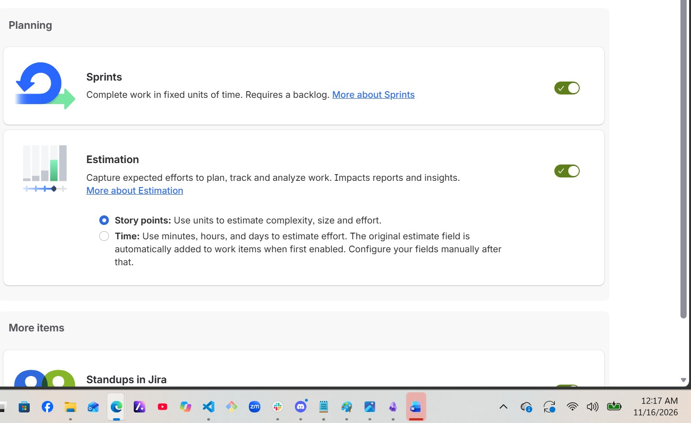
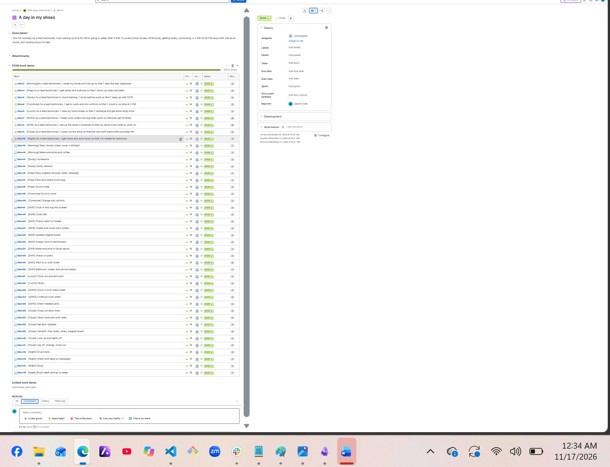
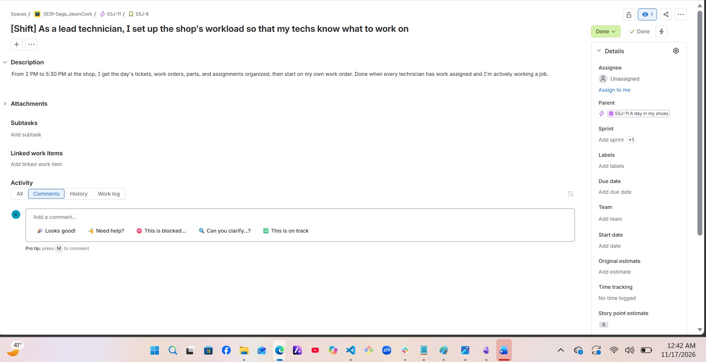
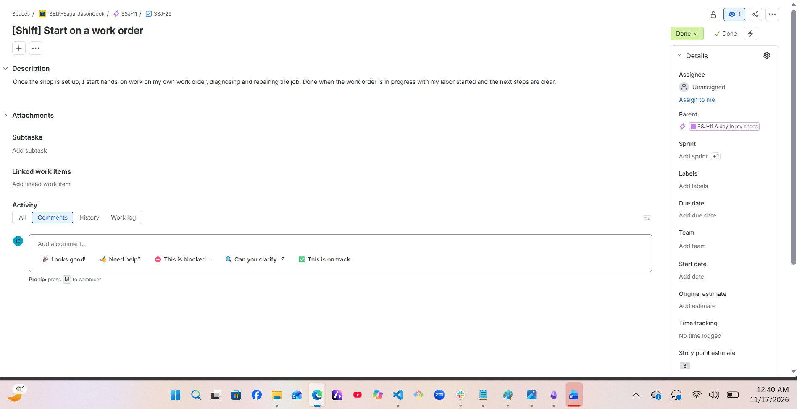
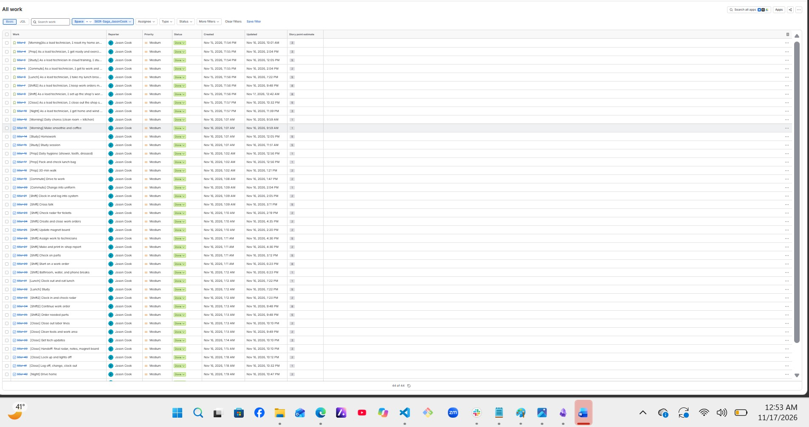

# Lesson 3 — Jira: A Day in My Shoes

## Space

- **Space name and key:** `SEIR-Saga_JasonCook` / `SSJ`
- **Template:** Scrum, team-managed
- **Estimation:** Story points (see `screenshots/jira_estimation_on.jpg`)

## Evidence table

| Key | Type | Summary | Story points |
|-----|------|---------|--------------|
| SSJ-11 | Epic | A day in my shoes | — |
| SSJ-2 | Story | [Morning] As a lead technician, I reset my home and fuel up so that I start the day organized | 3 |
| SSJ-12 | Task | [Morning] Daily chores (clean room + kitchen) | 1 |
| SSJ-13 | Task | [Morning] Make smoothie and coffee | 1 |
| SSJ-3 | Story | [Study] As a lead technician in cloud training, I study before work so that I keep up with SEIR | 5 |
| SSJ-14 | Task | [Study] Homework | 5 |
| SSJ-15 | Task | [Study] Study session | 5 |
| SSJ-4 | Story | [Prep] As a lead technician, I get ready and exercise so that I show up clean and alert | 3 |
| SSJ-16 | Task | [Prep] Daily hygiene (shower, teeth, dressed) | 1 |
| SSJ-17 | Task | [Prep] Pack and check lunch bag | 1 |
| SSJ-18 | Task | [Prep] 30-min walk | 2 |
| SSJ-5 | Story | [Commute] As a lead technician, I get to work and into uniform so that I clock in on time at 2 PM | 2 |
| SSJ-19 | Task | [Commute] Drive to work | 2 |
| SSJ-20 | Task | [Commute] Change into uniform | 1 |
| SSJ-8 | Story | [Shift] As a lead technician, I set up the shop's workload so that my techs know what to work on | 8 |
| SSJ-21 | Task | [Shift] Clock in and log into system | 2 |
| SSJ-22 | Task | [Shift] Cross talk | 5 |
| SSJ-23 | Task | [Shift] Check radar for tickets | 2 |
| SSJ-24 | Task | [Shift] Create and close work orders | 2 |
| SSJ-25 | Task | [Shift] Update magnet board | 2 |
| SSJ-26 | Task | [Shift] Assign work to technicians | 5 |
| SSJ-27 | Task | [Shift] Make and print in-shop report | 2 |
| SSJ-28 | Task | [Shift] Check on parts | 5 |
| SSJ-29 | Task | [Shift] Start on a work order | 8 |
| SSJ-30 | Task | [Shift] Bathroom, water, and phone breaks | 1 |
| SSJ-6 | Story | [Lunch] As a lead technician, I take my lunch break so that I recharge and get extra study time | 5 |
| SSJ-31 | Task | [Lunch] Clock out and eat lunch | 1 |
| SSJ-32 | Task | [Lunch] Study | 5 |
| SSJ-7 | Story | [Shift2] As a lead technician, I keep work orders moving after lunch so that jobs get finished | 8 |
| SSJ-33 | Task | [Shift2] Clock in and check radar | 2 |
| SSJ-34 | Task | [Shift2] Continue work order | 8 |
| SSJ-35 | Task | [Shift2] Order needed parts | 5 |
| SSJ-9 | Story | [Close] As a lead technician, I close out the shop so that the next shift starts with accurate info | 5 |
| SSJ-36 | Task | [Close] Close out labor lines | 2 |
| SSJ-37 | Task | [Close] Clean tools and work area | 2 |
| SSJ-38 | Task | [Close] Get tech updates | 3 |
| SSJ-39 | Task | [Close] Handoff: final radar, notes, magnet board | 3 |
| SSJ-40 | Task | [Close] Lock up and lights off | 2 |
| SSJ-41 | Task | [Close] Log off, change, clock out | 1 |
| SSJ-10 | Story | [Night] As a lead technician, I get home and wind down so that I'm rested for tomorrow | 3 |
| SSJ-42 | Task | [Night] Drive home | 2 |
| SSJ-43 | Task | [Night] Check and reply to messages | 3 |
| SSJ-44 | Task | [Night] Study | 3 |
| SSJ-45 | Task | [Night] Brush teeth and go to sleep | 1 |

**Counts:** 1 epic, 9 stories, 34 tasks. Every story and task has the epic as its Parent.

**Total story points of all stories and tasks:** 138 (stories 42 + tasks 96)

**My biggest task, and why I estimated it that way:**

**SSJ-29 [Shift] Start on a work order (8 points).** As a diesel technician, starting on a work order is the true beginning of my workday, because that's when I inspect, diagnose, and repair diesel trucks. As a lead technician, I'm also responsible for performing preventive maintenance inspections, ordering parts, and assigning work to my technicians.

I gave it 8 points, the most of any task, because diagnosing a truck is unpredictable. It's mentally demanding, calling on my 20 years of experience and knowledge, and it's also physically demanding, since I may have to climb on or under the truck to perform inspections and repairs. I often get pulled away to help my techs, which adds to the difficulty. My 5-point tasks, like Cross talk, take effort, but I know what to expect.

## Screenshots

| Screenshot | Shows |
|------------|-------|
|  | Space settings → Features, Estimation ON with Story points |
|  | The epic with its child work items and points |
|  | A story with its Parent, description, and Story point estimate |
|  | A task with its Parent, description, and Story point estimate |
|  | The backlog with all stories and tasks and their points |

## Extra credit evidence table

Details, Instance IDs, and explanations are in [lesson3_notes.md](lesson3_notes.md).

| Item | Requirement | Due | Screenshot | Done? |
|------|-------------|-----|------------|-------|
| BAM_5.1 | `jira_install.md` Steps 4–5: private note (email blurred) + test incident open | Sat 11/14, 2 PM ET | `screenshots/BAM_5.1.jpg` | Yes |
| BAM_5.2 | `jira.py --verify` succeeds on EC2 | Sat 11/14, 2 PM ET | `screenshots/BAM_5.2.jpg` | Yes |
| BAM_5.3 | `incident.py --test` shows Jira key + Slack delivery | Sat 11/14, 2 PM ET | `screenshots/BAM_5.3.jpg` | Yes |
| BAM_5.4 | Slack alert with clickable Jira link | Tue 11/17, 12 PM ET | `screenshots/BAM_5.4.jpg` | Yes |
| BAM_5.5 | Jira issue created by `incident.py` | Tue 11/17, 12 PM ET | `screenshots/BAM_5.5.jpg` | Yes |
| BAM_5.6 | Same incident ID twice → same Jira key | Tue 11/17, 12 PM ET | `screenshots/BAM_5.6.jpg` | No |
| BAM_5.7 | One-day sprint completed; burndown or sprint report | Tue 11/17, 12 PM ET | `screenshots/BAM_5.7.jpg` | Yes |
